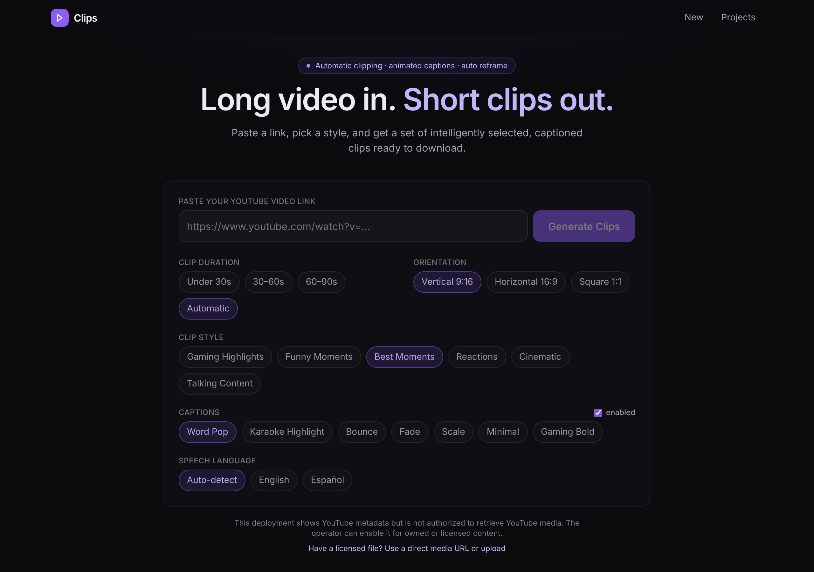
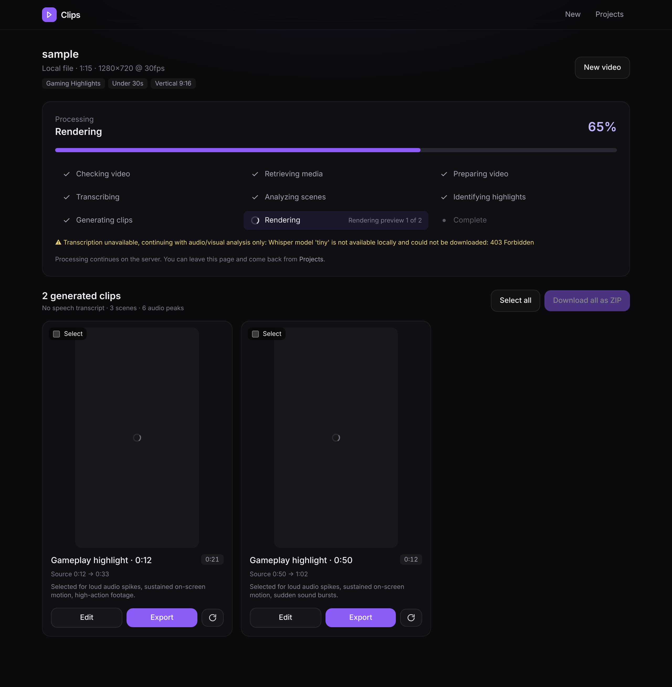
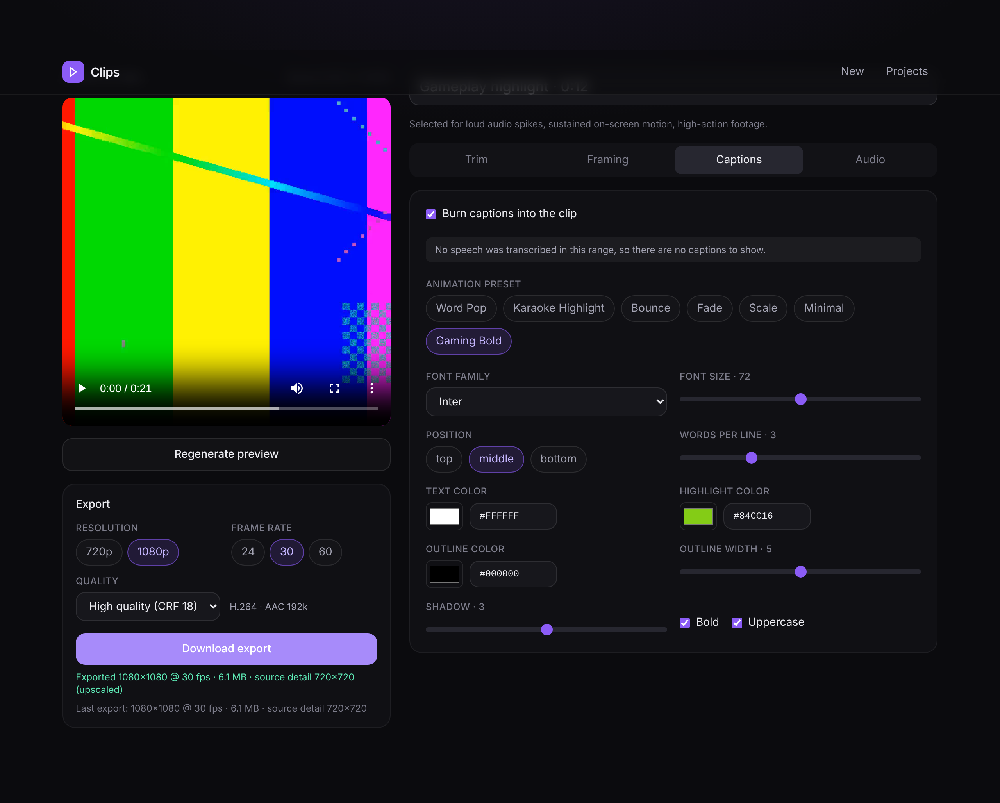

# Clips — automatic short-form clips from long videos

Paste a video link → the backend retrieves the media (where permitted), transcribes it, analyses
scenes / audio / motion, picks the strongest moments, auto-reframes them to vertical, burns in
animated captions and renders H.264 MP4s you can preview, tweak and download (individually or as
a ZIP). Processing runs in background workers, so you can close the tab and come back.

```
frontend/   Next.js 15 · React 19 · TypeScript · Tailwind v4 · Motion
backend/    FastAPI · SQLAlchemy/PostgreSQL · Celery + Redis · FFmpeg (libx264, libass)
            faster-whisper · PySceneDetect · OpenCV · NumPy · optional Anthropic SDK · S3/MinIO
```

## How it works

| Stage (shown live in the UI) | What actually happens |
|---|---|
| Checking video | URL validated, video ID extracted, metadata fetched (YouTube oEmbed / Data API, HTTP HEAD, ffprobe), **access policy evaluated** |
| Retrieving media | Media acquisition adapter obtains the source file (yt-dlp *only* on authorized deployments, direct https URL, upload, local file) |
| Preparing video | ffprobe, 16 kHz mono analysis audio, source fingerprint for caching |
| Transcribing | faster-whisper with word timestamps (en/es), cached per source |
| Analyzing scenes | PySceneDetect cuts, RMS energy peaks / onsets / silences, 1 fps sampled frames → motion, motion centroid, face boxes, facecam detection — all cached |
| Identifying highlights | Per-second feature tracks → sentence-aligned candidate windows → style-weighted scoring → de-duplicated selection → optional Claude re-ranking with titles/reasons |
| Generating clips | Boundaries snapped to word edges (never mid-word), caption words attached, per-clip settings created |
| Rendering | FFmpeg: timeline (optional silence removal) → auto-reframe crop path / fill / fit / facecam split → libass animated captions → loudnorm → H.264/AAC |

Every clip stores its **source start/end**, title, selection reason, the signals that drove the
decision, the preview and export object keys. Nothing is faked: if media cannot be retrieved the job
fails with the real reason; if Whisper is unavailable the job continues on audio/visual signals and
says so in a warning.

### Media access policy (read this before deploying)

YouTube's API Services Terms prohibit downloading or storing audiovisual content without prior
written approval. The application therefore ships with `YOUTUBE_MEDIA_RETRIEVAL=disabled`: YouTube
links still resolve to title / thumbnail / duration, but the UI shows a real "media retrieval not
available" state and the API answers `403 media_access_denied`. Set
`YOUTUBE_MEDIA_RETRIEVAL=authorized` only when the deployment processes content you own, are
licensed for, or have written approval for; optionally restrict it with
`YOUTUBE_ALLOWED_CHANNEL_IDS` (+ `YOUTUBE_API_KEY`) and your own `YTDLP_COOKIES_FILE`.
Direct media URLs and uploads are a secondary ingestion path for files you hold the rights to.
All outbound fetches go through an SSRF guard (public hosts only, standard ports, redirect hops
re-validated).

## Running locally

Requirements: Python 3.11+, Node 20+, FFmpeg with libx264 + libass, Redis, PostgreSQL
(SQLite works for development), fontconfig with at least one sans font (Inter recommended).

```bash
cp .env.example .env                      # review the policy + storage settings
python3 -m venv .venv && .venv/bin/pip install -r backend/requirements.txt
cd frontend && npm install && cd ..

# four terminals (or: make api / make worker / make beat / make web)
cd backend && ../.venv/bin/uvicorn app.main:app --reload --port 8000
cd backend && ../.venv/bin/celery -A app.workers.celery_app:celery_app worker -Q analysis,render -c 2
cd backend && ../.venv/bin/celery -A app.workers.celery_app:celery_app beat     # hourly cleanup
cd frontend && npm run dev                                                   # http://localhost:3000
```

The first transcription downloads the Whisper model (`WHISPER_MODEL=small` by default) into
`WHISPER_CACHE_DIR`. Set `ANTHROPIC_API_KEY` to enable LLM-assisted ranking and titles
(`claude-opus-5-5`); without it, ranking is purely signal-based and titles come from the transcript.

### Docker

```bash
docker compose up --build
```
Brings up PostgreSQL, Redis, MinIO (S3-compatible, bucket auto-created), the API, a worker, beat
and the frontend. Previews/exports are stored in MinIO and served via `S3_PUBLIC_BASE_URL`.

## API

| Method | Path | Purpose |
|---|---|---|
| `POST` | `/api/videos/inspect` | Validate a link, return metadata + access decision (no job) |
| `POST` | `/api/videos/analyze` | Create a project + analysis job (`youtubeUrl`, `clipDuration`, `clipStyle`, `orientation`, `captionStyle`, `captionsEnabled`, `language`) → `202` |
| `POST` | `/api/videos/upload` | Secondary ingestion: multipart upload → `upload://token` |
| `GET` | `/api/jobs/{id}` | Real job state: stage, progress, stage history, warnings, metrics, result |
| `GET` | `/api/projects` · `/api/projects/{id}` | List / reopen projects (clips + active job) |
| `POST` | `/api/projects/{id}/retry` · `DELETE /api/projects/{id}` | Retry failed analysis / delete |
| `POST` | `/api/projects/{id}/download-all` | Export selected clips (renders missing exports) and package a ZIP → job |
| `GET` | `/api/clips/{id}` · `PATCH /api/clips/{id}` | Read / edit: title, trim (`start_time`, `end_time`), `settings` (deep-merged), `caption_preset`, `caption_words`, `caption_text` |
| `POST` | `/api/clips/{id}/render` | Render `preview` or `export` (optional export overrides) → job; identical settings are served from cache |
| `GET` | `/api/clips/{id}/download` | `302` to the export, `409` if not exported yet |
| `GET` | `/api/options` | What this server can do: fonts, presets, music tracks, ingest modes, limits |
| `GET` | `/api/media/{key}` | Local-storage file serving with HTTP range support |

Errors are `{"detail": {"code": "...", "message": "..."}}`. Routes only validate and enqueue;
all processing lives in `backend/app/services/` and runs in Celery tasks.

### Clip settings (`Clip.settings`)

`orientation` (9:16 default, 16:9, 1:1) · `reframe` (`auto` subject tracking, `fill` centre crop,
`fit` blurred backdrop) · `crop_offset_x/y` · `facecam_layout` (stacked facecam + gameplay when a
facecam was reliably detected) · `remove_silence` · `captions` (enabled, animation preset — Word Pop,
Karaoke Highlight, Bounce, Fade, Scale, Minimal, Gaming Bold — font family/size, text / highlight /
outline colours, outline width, shadow, position, words per line, bold, uppercase) · `audio`
(loudness normalisation, source volume, licensed music track + volume) · `export` (720p/1080p,
24/30/60 fps capped at the source rate, CRF or bitrate, x264 preset).

Changing a subtitle font re-renders only that clip; transcript, scene, audio and vision analysis are
cached by source fingerprint and never recomputed. Exports record the native crop resolution and an
`upscaled` flag so a 608×1080 crop from a 1080p source is never presented as recovered detail.

## Cost, limits and retention

- Frames are sampled at 1 fps / 320 px for vision, scene detection skips frames, audio is analysed at
  16 kHz mono.
- `MAX_SOURCE_DURATION_SECONDS`, `MAX_SOURCE_BYTES`, `MAX_UPLOAD_BYTES`, per-IP
  `RATE_LIMIT_ANALYZE_PER_HOUR`, `MAX_ACTIVE_ANALYSIS_JOBS`, free-disk checks before retrieval.
- Celery retries transient retrieval failures with backoff; failed renders are recorded per clip.
- Source working copies expire after `SOURCE_RETENTION_HOURS` (re-acquired on demand if still
  permitted); previews/exports after `OUTPUT_RETENTION_DAYS`; the beat scheduler runs cleanup hourly.
- Job metrics include per-stage seconds, CPU seconds, source bytes, candidate counts.

## Tests

```bash
cd backend && ../.venv/bin/pytest -q        # 58 tests
cd frontend && npx tsc --noEmit && npm run build
```

The backend suite synthesises a real 75 s test video with FFmpeg (three hard cuts, loud audio bursts)
and runs the whole API → pipeline → render → export → ZIP flow against it, plus unit tests for URL
parsing, SSRF guards, highlight scoring, caption/ASS generation, timelines and reframing. The YouTube
adapter is exercised with stubbed metadata/acquisition because the test environment has no YouTube
access; speech transcription is exercised through fixture transcripts for the same reason (the
Whisper model cannot be downloaded in the sandbox). Run the suite on a machine with network access
to also cover model download and, where you are authorized, real YouTube retrieval.

## Not in this MVP

Authentication / multi-tenant billing (projects are scoped per browser via an owner token), HEVC/AV1
and 4K exports, a multitrack timeline, bundled music (bring your own licensed library via
`MUSIC_LIBRARY_DIR`).

## Screenshots




